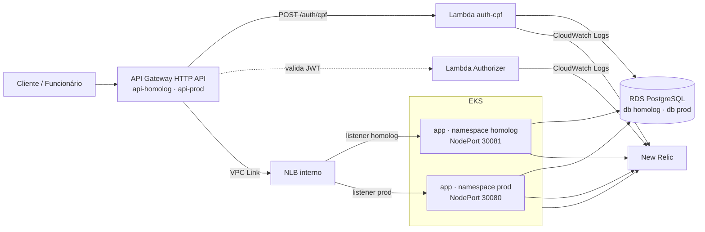

# Fase 3 — Plano e progresso

Fonte de verdade do trabalho da Fase 3. Atualizado incrementalmente.

**Status geral:** E0 concluída; **E1 em andamento**.
**Última atualização:** 2026-10-25
**Prazo de entrega: 01/11/2026** (informado pelo usuário em 2026-10-25). Trabalho só do usuário + Claude (ninguém do grupo em paralelo). Cronograma na seção 5.2.

## 1. Decisões tomadas (não rediscutir)

| # | Tema | Decisão |
|---|---|---|
| D1 | Nuvem/conta | AWS, conta AWS Academy (Learner Lab), tudo com a `LabRole` |
| D2 | API Gateway | AWS API Gateway **HTTP API** |
| D3 | Runtime da Function | **Node.js + TypeScript** (AWS Lambda) |
| D4 | Observabilidade | **New Relic** |
| D5 | Modelo de autenticação | CPF (sem senha) **apenas para clientes**, via Lambda, emitindo JWT com role `CLIENTE`. ADMIN/FUNCIONARIO continuam em `POST /auth/login` (e-mail + senha) na aplicação, exposto pelo gateway |
| D6 | JWT | **HS256** com segredo compartilhado; validação na borda por **Lambda Authorizer** e também na aplicação (Spring Security, como hoje) |
| D7 | Status do cliente | Nova coluna **`status`** em `clientes` (texto com CHECK, default `ATIVO`); a Lambda só emite token para cliente ativo |
| D8 | Dono dos repositórios | Conta GitHub **daniellrsouza** |
| D9 | Ambientes | **1 cluster EKS + 1 instância RDS**; namespaces `homolog` e `prod`, um database por ambiente, **uma HTTP API por ambiente** (revisto em 2026-10-20 após o spike: era "um stage por ambiente"; o authorizer não pode ser escolhido por stage variable). As duas APIs compartilham o VPC Link e o NLB. Branch `develop` → homolog, `main` → prod |
| D10 | Migrations | **Flyway continua na aplicação**; o repositório do banco provisiona só infraestrutura |
| D11 | Notificações serverless | **Fora do escopo**; e-mail continua via SMTP na aplicação |
| D12 | Visibilidade | Repositórios **públicos** |
| D13 | Repositório atual | O repositório atual **vira o da aplicação** (mantém histórico, PRs e SonarCloud); `infra/` sai para repositório novo com histórico extraído (feito com `git subtree split`, equivalente ao `git filter-repo` para um diretório) |
| D14 | Terraform do API Gateway | **Dividido**: infra K8s cria as APIs (uma por ambiente), o VPC Link e a integração com o NLB; o repo da Lambda cria funções, authorizer e rotas |
| D15 | Documentação de arquitetura | `docs/` no repositório da aplicação; os outros READMEs apontam para lá |
| D16 | Nomes | `postech-16soat-lambda`, `postech-16soat-infra-k8s`, `postech-16soat-infra-db`, `postech-16soat-app` |

| D17 | Bucket do state Terraform | Cada pipeline cria o bucket se não existir (passo idempotente antes do `terraform init`, com versionamento e bloqueio de acesso público); o bucket fica fora de qualquer state. Substitui o módulo `backend/` + `state-bucket.tf` atuais |
| D18 | Versão do Terraform | **1.15.x** no CI e local; lock nativo do backend S3 (`use_lockfile = true`), sem DynamoDB |

| D19 | Nome do bucket de state | `tfstate-<id-da-conta>-postech-16soat`, calculado pelo pipeline (`aws sts get-caller-identity`) e passado por `-backend-config` |
| D20 | Add-ons do cluster | Instalados pelo **provider `helm` do Terraform** (charts oficiais com versão fixada); sem binário helm local ou no CI |
| D21 | Fluxo de branches | `feature/*` (a partir da `develop`) → PR para `develop` (deploy homolog) → PR `develop` → `main` (deploy prod) |
| D22 | Commits do Claude | Autorizado commit **e push** em branches `feature/*`; nunca em `develop`/`main`; PRs só a pedido do usuário |

| D23 | Modelagem do banco | **Revisão dirigida pelo PDF, enxuta** (definido em 2026-10-25): coluna `status` + índices para as consultas dos dashboards + 1–2 constraints óbvias, tudo justificado. Na E4: análise do schema atual focada em consistência e performance (ex.: índices para as consultas dos dashboards, constraints faltantes); só entram ajustes justificados e aprovados pelo usuário, cada um documentado na E6.5 |
| D24 | Proteção da `main` × admin | **Mantido** "admin pode furar" mesmo ciente do texto do PDF ("sem commits diretos"), reconfirmado em 2026-10-23. Convenção: o Claude nunca faz push na `main` (D22) |

| D25 | Confirmações | **Homolog liberado** (2026-10-25): plan/apply em homolog sem pedir confirmação, mostrando o resumo do plan antes; apply que **destrua** recurso existente, qualquer coisa em **prod** e ações no GitHub continuam pedindo confirmação. Exceção liberada em 2026-10-25: **substituição do Job de bootstrap do banco** (recurso efêmero) em homolog não pede confirmação |
| D26 | Libs da Lambda | `jose` (JWT HS256) + `pg` (Postgres) |
| D27 | Build e testes da Lambda | `esbuild` (um bundle por função) + `Vitest` (com cobertura) |

| D28 | Instância RDS | PostgreSQL 16, **db.t3.micro, Single-AZ** (sem failover: limitação de custo do lab, a registrar na justificativa do banco) |
| D29 | Usuários do banco | Por ambiente: **usuário da aplicação** (dono do schema, usado pelo Flyway) + **usuário só-leitura em `clientes` para a Lambda**; o master só é usado pelo Job de bootstrap (P8) |

| D30 | Senha master do RDS | **Gerenciada pela AWS** (`manage_master_user_password`, guardada no Secrets Manager); o Terraform a lê só para o Job de bootstrap. Se a LabRole não permitir, volta a ser GitHub Secret |
| D31 | **Orçamento AWS** | **Limite rígido de US$ 50** no Learner Lab até a entrega (gasto em 2026-10-25: US$ 8,40). Medidas: homolog com 1 réplica; node group com no máximo 2 nós; relatório de custo a cada sessão; **nós desligados (node group em 0) quando o usuário parar de trabalhar** e religados na sessão seguinte. Destino da infra após a entrega: decidir em 30/10 olhando o saldo |

| D32 | Documentação | Diagramas em **Mermaid** dentro dos `.md`; documentação escrita **em paralelo**, a partir de 2026-10-25 (ADRs/RFCs das decisões já tomadas e diagramas de infra primeiro; aplicação, observabilidade e banco à medida que cada etapa termina) |

| D33 | Ajustes do modelo (D23) | Aprovados A–G (2026-10-25): **A** `clientes.status` + GRANT por coluna para `leitura_clientes`; **B** CHECK de movimentação com VENDA/RESERVA (bug); **C** índices compostos das consultas reais; **D** índices nas FKs `veiculo_id`/`mecanico_id`; **E** remoção de 4 índices duplicados de UNIQUE; **F** `ddl-auto: validate`; **G** CPF inválido do seed corrigido. Migrations V17–V20 |
| D34 | Eventos de negócio | **API do agente Java** do New Relic (`newrelic-api`, no-op sem agente); conta New Relic **US**, Account ID **8662599** |
| D35 | SMTP na nuvem | Usuário cadastra `MAIL_USERNAME`/`MAIL_PASSWORD` com **a própria conta Gmail** (2026-10-26: a `oficinagrupo015@gmail.com` não é mais dele); default exposto removido do `application.yml`. A senha antiga dessa conta segue no histórico público: **avisar o dono da conta no grupo para revogá-la** |
| D36 | SonarCloud | `sonar.yml` pula a análise com aviso quando não há `SONAR_TOKEN` neste repositório |

| D37 | HPA de prod | **Só por CPU** (alvo 70%, 2–6 réplicas), decidido em 2026-10-26: a JVM ficou em 79% da memória reservada sem carga, e o alvo de 75% de memória escalaria sem demanda. ADR-007 atualizado |

D1–D16 tomadas em 2026-10-10; D17–D18 em 2026-10-20; D19–D24 em 2026-10-23; D25–D36 em 2026-10-25; D37 em 2026-10-26. **D11 reconfirmada em 2026-10-23**, ciente do risco: a justificativa vai em ADR na E6.4.

## 2. Premissas técnicas — todas confirmadas pelo usuário em 2026-10-12

Revisadas uma a uma; em todas foi mantida a coluna "Premissa". Valem como decisão (não rediscutir). A coluna "Alternativa" registra o que foi descartado.

| # | Decisão | Alternativa descartada | Etapa |
|---|---|---|---|
| P1 | Valores de `clientes.status`: `ATIVO`, `INATIVO`, `BLOQUEADO` | Outro conjunto de valores | E4 |
| P2 | Claims do token de cliente: `sub` = id do cliente (UUID), `role` = `CLIENTE`, `iss` = `tech-challenge-auth`, expiração de 1h. CPF não vai no token | `sub` = CPF | E3, E4 |
| P3 | Contrato da Lambda: `POST /auth/cpf` com `{"cpf": "..."}`, resposta `{"accessToken": "..."}` (mesmo formato do `/auth/login`). CPF inválido → 400; inexistente → 404; não ativo → 403 | Resposta única 401 para os três casos (não revela existência do CPF) | E3 |
| P4 | Contrato entre repositórios via **SSM Parameter Store** (`/tech-challenge/<env>/...`): cada pipeline publica seus outputs e o seguinte lê | `terraform_remote_state` lendo o state dos outros repositórios | E1 |
| P5 | **Revisto em 2026-10-25:** senhas dos usuários do banco por ambiente e `JWT_SECRET` por ambiente são **geradas pelo Terraform do infra-db** (`random_password`) e publicadas como **SSM SecureString** em `/tech-challenge/<env>/...`; Lambda (Terraform → env var) e pipeline da app (→ Secret do Kubernetes) leem de lá. Master do RDS: D30. License key do New Relic: GitHub Secret | Valores cadastrados à mão como GitHub Secrets em cada repo (risco de divergência); Secrets Manager lido em runtime pela Lambda (exige VPC endpoint/NAT) | E2, E3, E4 |
| P6 | Rede: subnets **privadas** (sem rota para internet) para RDS, Lambda, NLB e VPC Link; **sem NAT Gateway**. Revisto em 2026-10-23: **3 subnets privadas** (uma por AZ dos nós), depois que o teste fim a fim mostrou o nó de `us-east-1c` como `Target.NotInUse` no NLB; o VPC Link fica nas 2 primeiras | NAT Gateway (custo fixo relevante no orçamento do lab) | E1 |
| P7 | Entrada do cluster **sem ingress controller** (revisto em 2026-10-23: o ingress-nginx original chegou ao fim da vida em março de 2026): o Service da app em cada namespace é `NodePort` fixo (**prod 30080, homolog 30081**); **NLB interno criado pelo Terraform** com um listener e um target group por ambiente; cada API aponta para o listener do seu ambiente, sem reescrita de path. Não depende do AWS Load Balancer Controller (exigiria IRSA) | ingress-nginx (aposentado); Traefik; Gateway API (Envoy Gateway); Service `LoadBalancer` | E1, E4 |
| P8 | Database do ambiente criado por um **Job no cluster** disparado pelo pipeline do banco (o runner do GitHub não alcança o RDS privado) | Um único database com um schema por ambiente, criado pelo próprio Flyway | E2 |
| P9 | Stacks Terraform dos repos de infra separadas em `shared` e `env`: `develop` aplica `env=homolog`; `main` aplica `shared` + `env=prod` | Um único stack aplicado só pela `main` | E1, E2 |
| P10 | **Revisto em 2026-10-25 (prazo):** dashboards, alertas e monitor sintético criados **pela interface do New Relic**, com o JSON exportado versionado em `docs/` | Provider Terraform `newrelic` (≈0,5 dia a mais) | E5 |
| P11 | **Revisto em 2026-10-25 (prazo):** logs JSON da Lambda **só no CloudWatch**; o New Relic cobre aplicação, cluster e as falhas de integração vistas pela aplicação | Forwarder CloudWatch → New Relic; extensão New Relic + NAT | E5 |
| P12 | Não haverá endpoint novo para alterar o status do cliente (o PDF só pede a consulta); a demonstração de cliente inativo será feita via SQL/seed | Criar endpoint administrativo de alteração de status | E4 |

## 3. Estado atual do repositório (levantado em 2026-10-10)

- Monorepo: app, `k8s/` e `infra/` (Terraform) dentro de `tech-challenge-backend/`; pipelines na raiz.
- Infra existente: VPC com 3 subnets públicas, EKS 1.36 (`eks-tech-challenge`), node group 2–3 `t3.medium`, ECR, state em S3. Postgres roda como **StatefulSet no cluster** (não gerenciado).
- O Terraform de infra aplica também os manifests da aplicação (`infra/k8s-*.tf` leem `../k8s/`), acoplando infra e app.
- Ingress `nginx` declarado, sem ingress controller instalado e sem API Gateway.
- Autenticação: `POST /auth/login` por e-mail + senha na aplicação; JWT HS256 (`JWT_SECRET`), claim `role`, `sub` = e-mail, expiração 1h. `OrdemServicoController` usa `jwt.getSubject()` para registrar quem alterou o status.
- `clientes` não tem coluna de status; `usuarios` e `clientes` têm `cpf_cnpj` único.
- Sem observabilidade: sem logs JSON, sem correlation id, sem APM, sem métricas de negócio.
- CI/CD: `pipeline.yml` (build, testes, push ECR, deploy EKS), `terraform.yml`, `sonar.yml`; só o ambiente `production`, deploy em push na `main`.
- `os_historico_status` já registra as transições de status (base para o tempo médio por status).

## 4. Arquitetura alvo

Rotas no gateway: públicas (`POST /auth/cpf` → Lambda; `POST /auth/login`, `/api/public/**`, health e Swagger → aplicação) e protegidas (todo o restante → aplicação, com Lambda Authorizer).

### Responsabilidade de cada repositório

| Repositório | Conteúdo | Deploy |
|---|---|---|
| `postech-16soat-infra-k8s` | VPC, subnets, EKS, node group, ECR, namespaces, metrics-server, NLB interno (listener por ambiente), API Gateway (uma API por ambiente, VPC Link, integração), integração Kubernetes do New Relic, dashboards e alertas | Terraform |
| `postech-16soat-infra-db` | RDS PostgreSQL, subnet group, security group, parameter group, databases por ambiente | Terraform |
| `postech-16soat-lambda` | Código TypeScript das funções `auth-cpf` e `authorizer`, testes, e Terraform das funções, do authorizer e das rotas do gateway | Terraform + pacote zip |
| `postech-16soat-app` | Aplicação Spring Boot, Dockerfile, manifests Kubernetes da aplicação (overlays por ambiente), migrations Flyway, `docs/` de arquitetura | Imagem no ECR + `kubectl apply -k` |

Ordem de provisionamento: infra-k8s → infra-db → lambda → app.

## 5. Plano de implementação

### E0 — Preparação dos repositórios
1. Renomear o repositório atual (`daniellrsouza/postech-16SOAT`, já público e **não** marcado como fork no GitHub) para `postech-16soat-app` (D13) e atualizar o remote local.
2. Criar `postech-16soat-infra-k8s` a partir do histórico de `tech-challenge-backend/infra/` (`git subtree split`), e criar `postech-16soat-infra-db` e `postech-16soat-lambda` vazios.
3. Em cada um dos 4: branches `main` e `develop`; proteção de `main` (e `develop`) com PR obrigatório e checks obrigatórios, sem push direto; environments `homolog` e `prod` no GitHub; secrets AWS e New Relic; adicionar o colaborador `soat-architecture`.
4. Script para atualizar os secrets AWS nos 4 repositórios a cada nova sessão do Learner Lab (as credenciais expiram).

### E1 — `postech-16soat-infra-k8s`
1. Reorganizar o Terraform em `shared` e `env` (P9); state remoto no bucket S3 existente, uma chave por stack.
2. Remover deste repositório tudo que é da aplicação: `k8s-deployment`, `k8s-service`, `k8s-hpa`, `k8s-pdb`, `k8s-ingress`, `k8s-configmap`, `k8s-secret`, e o Postgres (`k8s-postgres-*`, `k8s-storageclass`, addon EBS CSI).
3. Rede: subnets privadas para RDS e Lambda (P6); security groups.
4. Cluster: manter EKS, node group, ECR e metrics-server (via helm, D20); criar namespaces `homolog` e `prod`; NLB interno no stack `shared`; listener + target group (NodePort do ambiente) + liberação da porta no security group dos nós no stack `env` (P7).
5. API Gateway: uma HTTP API por ambiente (D9), com stage `$default` e auto-deploy; um VPC Link compartilhado; integração privada com o listener do NLB do próprio ambiente (sem reescrita de path: com stage `$default` o path chega inteiro); access logs em JSON no CloudWatch (incluir `$context.requestId`; um log group por API).
6. Publicar os outputs no SSM (P4): ids de VPC/subnets/SGs, nome do cluster, URL do ECR, id da API, id da integração.
7. Pipeline: PR → `fmt`, `validate`, `plan`; `develop` → apply de homolog; `main` → apply de shared + prod; `destroy` apenas manual.
8. README: propósito, tecnologias, execução/deploy, diagrama da infra, link do Swagger/Postman.

### E2 — `postech-16soat-infra-db`
1. RDS PostgreSQL 16 em subnets privadas, não público, criptografado, backup automático; security group liberando 5432 apenas para os nós do EKS e para a Lambda.
2. Parameter group com log de queries lentas (insumo para a análise de performance).
3. Databases `homolog` e `prod` criados por Job no cluster (P8).
4. Publicar endpoint, porta e nomes dos databases no SSM.
5. Pipeline e README no mesmo padrão da E1.

### E3 — `postech-16soat-lambda`
1. Função `auth-cpf`: valida formato e dígitos verificadores do CPF; consulta `clientes` por CPF; verifica `status`; emite JWT HS256 com as claims de P2; respostas conforme P3; log JSON com correlation id.
2. Função `authorizer`: valida assinatura, emissor e expiração; devolve a decisão e repassa `sub` e `role` no contexto.
3. Testes unitários (CPF, cliente inexistente, cliente inativo, token expirado/adulterado) e lint.
4. Terraform: funções por ambiente na VPC com a `LabRole`, authorizer no gateway, rotas públicas e protegidas apontando para a integração criada na E1.
5. Pipeline: PR → lint, testes, build, `plan`; `develop` → deploy homolog; `main` → deploy prod.
6. README no padrão, com coleção Postman do endpoint de autenticação.

### E4 — `postech-16soat-app`
1. **Modelo de dados:** migration `V17` adicionando `clientes.status` (D7/P1) com CHECK, default e índice; refletir no domínio (`Cliente`), na entidade JPA, no mapper e nos DTOs de resposta; testes.
1b. **Revisão do modelo (D23):** levantar consultas reais (dashboards, listagens, acompanhamento) e o schema; propor ajustes de consistência e performance com justificativa; aplicar só os aprovados, em migrations novas e com testes.
2. **Segurança:** aceitar o emissor da Lambda além do atual; validar o comportamento de `jwt.getSubject()` com token de cliente (hoje o `sub` é e-mail); manter `/auth/login`. Testes de integração com token no formato da Lambda.
3. **Banco gerenciado:** remover o StatefulSet do Postgres dos manifests; datasource apontando para o RDS por ambiente.
4. **Manifests:** `k8s/base` + overlays `homolog` e `prod` (namespace, réplicas, HPA, ConfigMap, Service `NodePort` com a porta fixa do ambiente, P7). Remover o `app-ingress.yaml` atual.
5. **Observabilidade (parte da aplicação):** ver E5, itens 1 a 4.
6. **Pipeline:** PR → build, unitários, integração, Sonar; `develop` → imagem no ECR + deploy em `homolog`; `main` → deploy em `prod` (trocar o `environment: production` atual do `pipeline.yml` pelos environments `homolog`/`prod` criados na E0.3a); Secret do Kubernetes montado no deploy a partir do SSM e dos GitHub Secrets; `rollout status` como gate.
7. Remover `infra/` e os workflows de Terraform deste repositório após a E1 estar validada.
8. README atualizado para a Fase 3, com link do Swagger e das coleções Postman.

### E5 — Monitoramento e observabilidade (New Relic)
1. **Logs estruturados:** saída JSON no console (recurso nativo do Spring Boot 3.5, sem dependência nova).
2. **Correlação:** filtro que lê ou gera `X-Correlation-Id`, coloca no MDC e devolve no response; o gateway propaga o id da requisição; a Lambda registra o mesmo id.
3. **APM e traces:** agente Java do New Relic na imagem, com distributed tracing e logs in context (latência das APIs, erros, traces).
4. **Métricas de negócio:** evento a cada OS criada e a cada transição de status, com o tempo gasto no status anterior; evento de falha no processamento de OS e nas integrações (SMTP, banco).
5. **Kubernetes:** integração do New Relic no cluster (CPU, memória, pods, HPA, eventos, logs dos pods).
6. **Healthcheck e uptime:** monitor sintético em `/actuator/health` de cada ambiente, passando pelo gateway.
7. **Alertas:** falhas no processamento de OS, taxa de erro e latência das APIs, health indisponível, pods reiniciando.
8. **Dashboards:** volume diário de OS; tempo médio por status (Diagnóstico, Execução, Finalização); erros e falhas nas integrações; latência das APIs; CPU e memória do cluster.

### E6 — Documentação de arquitetura (`docs/` no repo da aplicação)
1. Diagrama de componentes: nuvem, gateway, Lambda, EKS, RDS, monitoramento.
2. Diagramas de sequência: autenticação por CPF; abertura de ordem de serviço.
3. RFCs: escolha da nuvem; escolha do banco; estratégia de autenticação; escolha do API Gateway; escolha da ferramenta de observabilidade.
4. ADRs: notificações fora do escopo serverless (D11); HS256 + Lambda Authorizer; separação em 4 repositórios e contrato via SSM; ambientes por namespace; uso de HPA; padrão de comunicação (síncrono REST via gateway); migrations na aplicação; NLB + NodePort por ambiente, sem ingress controller (com o registro da aposentadoria do ingress-nginx).
5. Banco de dados: justificativa formal do PostgreSQL gerenciado, diagrama ER, explicação dos relacionamentos e dos ajustes no modelo (coluna `status`).

### E7 — Entrega
1. READMEs dos 4 repositórios revisados (propósito, tecnologias, execução e deploy, diagrama, link Swagger/Postman, links dos deploys ativos).
2. Vídeo de até 15 minutos: autenticação com CPF, pipeline CI/CD, deploy automatizado, consumo de API protegida, dashboard ao vivo, logs e traces.
3. PDF único: links dos 4 repositórios, do vídeo e das documentações, e confirmação do `soat-architecture` em todos.

### Achados do spike de roteamento por stage (2026-10-20)

Spike descartável (HTTP API com stages `homolog`/`prod`, Lambdas eco e Function URL fazendo papel de backend), criado e destruído na conta do lab. Nada ficou na conta.

| Pergunta | Resultado |
|---|---|
| Integração Lambda escolhida por stage variable (`...:function:x-$${stageVariables.env}`) | **Funciona.** A Lambda recebe `rawPath` **com** o prefixo do stage (`/homolog/auth/cpf`): o código da função não pode depender do path |
| Path reescrito com o ambiente (`overwrite:path = /$${stageVariables.env}/$${request.path.proxy}`) | **Funciona**, e a query string é preservada. Concatenação exige a forma com chaves `${...}`; a forma `$x` sem chaves é recusada |
| Integração HTTP sem reescrita | Entrega `/` ao backend (não repassa o path): reescrita ou `{proxy}` no URI é obrigatória |
| **Authorizer escolhido por stage variable no `authorizer_uri`** | **Não funciona.** O gateway nunca invoca a função (`The Lambda authorizer returned a 4xx error`, latência `-`). Com o nome fixo, o mesmo authorizer funciona (200 com o token do ambiente, 403 com o do outro) |
| Access logs em JSON no stage | Funcionam com a `LabRole`; o formato **exige** `$context.requestId`. Atualizar dois stages em paralelo falhou uma vez com "Insufficient permissions to enable logging" e passou na repetição: serializar os stages (`depends_on`) ou usar um log group por stage |

### Riscos
- ~~Roteamento por stage no HTTP API~~: resolvido pelo spike + revisão da D9 (uma API por ambiente).
- **Limites do Learner Lab:** serviços e ações disponíveis para a `LabRole` (Lambda em VPC, RDS, VPC Link) precisam ser confirmados logo na E1; orçamento e expiração de credenciais afetam a gravação do vídeo.
- **Token de cliente no backend:** trechos que assumem `sub` = e-mail podem se comportar diferente com token emitido pela Lambda.
- **Free tier do New Relic:** um usuário completo e 100 GB/mês; logs em DEBUG podem estourar o volume.

## 5.1 Rastreabilidade com o PDF (obrigatórios)

Conferida em 2026-10-23. Status: ✅ feito · ⏳ planejado (etapa) · ⚠️ atenção.

| Requisito do PDF | Onde é atendido | Status |
|---|---|---|
| API Gateway | D2, D9, D14; E1.5 | ⏳ E1 |
| Rotas sensíveis protegidas com autenticação via CPF | D5, D6 (Lambda Authorizer + Spring Security) | ⏳ E3, E4 |
| Function: validar CPF | E3.1 | ⏳ E3 |
| Function: consultar existência e **status** do cliente | D7, P1, E3.1, E4.1 (coluna `status`) | ⏳ E3, E4 |
| Function: gerar e devolver JWT válido para as APIs protegidas | D6, P2, P3, E3.1 | ⏳ E3 |
| 4 repositórios (Lambda, infra K8s, infra banco, aplicação) | D13, D16, E0 | ✅ E0 |
| CI/CD em cada repositório, com deploy automático na nuvem | E1.7, E2.5, E3.5, E4.6 | ⏳ |
| `main` protegida, sem commits diretos | E0.3a | ⚠️ protegida, mas **admin pode furar** (D24, reconfirmado ciente do risco) |
| PR obrigatório para merge | E0.3a | ✅ |
| Deploy automático das branches de homologação e produção | D9, D21, P9, environments da E0.3a | ⏳ pipelines |
| Infra: API Gateway, Function, banco gerenciado, Kubernetes com escalabilidade, Terraform | D2, D3, E2 (RDS), E1 (EKS + node group 2–3) + HPA da app (E4.4), Terraform em 3 repos | ⏳ |
| Integração com New Relic | D4, E5 | ⏳ E5 |
| Monitorar latência, CPU/memória do K8s, healthchecks/uptime | E5.3, E5.5, E5.6 | ⏳ E5 |
| Alertas para falhas no processamento de OS | E5.4, E5.7 | ⏳ E5 |
| Logs JSON com correlação entre requisições | E5.1, E5.2 (gateway injeta `X-Correlation-Id`) | ⏳ E1, E5 |
| Dashboards: volume diário de OS, tempo médio por status (Diagnóstico, Execução, Finalização), erros nas integrações | E5.8 | ⏳ E5 |
| Diagrama de componentes (nuvem, APIs, banco, monitoramento) | E6.1 | ⏳ E6 |
| Diagramas de sequência: autenticação e abertura de OS | E6.2 | ⏳ E6 |
| RFCs e ADRs | E6.3, E6.4 | ⏳ E6 |
| Justificativa do banco, ajustes no modelo relacional, ER e relacionamentos | E6.5, E4.1, E4.1b (D23) | ⏳ E4, E6 |
| Dockerfiles, pipelines funcionais, links dos deploys ativos | E4, E7.1 | ⏳ |
| README de cada repo: propósito, tecnologias, execução/deploy, diagrama do repo, link Swagger/Postman | E1.8, E2.5, E3.6, E4.8, E7.1 | ⏳ |
| Vídeo até 15 min (CPF, pipeline, deploy, APIs protegidas, dashboard ao vivo, logs e traces) | E7.2 | ⏳ E7 |
| PDF único com links e confirmação do `soat-architecture` | E7.3; convites enviados em E0.3 | ⚠️ convites aguardando aceite |
| Desafio: "soluções serverless para autenticação **e notificações**" | D11 (reconfirmada): fora do escopo; justificativa em ADR (E6.4) | ⚠️ escolha consciente |

## 5.2 Cronograma até a entrega (revisto em 2026-10-25: **entrega em 30/10, tentando 29/10**)

Formas de acelerar adotadas: código e testes adiantados sem AWS enquanto a sessão do lab está fora; documentação (ADRs/RFCs/diagramas) escrita junto com cada etapa; D25 (homolog sem confirmação).

| Dia | Entrega |
|---|---|
| 25/10 | Fechar E1 + **E2 RDS**; código e testes da **Lambda** (offline) |
| 26/10 | Deploy da **Lambda**; código da **aplicação** (`status`, modelo, token, logs JSON, correlation id) |
| 27/10 | **App** em homolog com fluxo de CPF ponta a ponta; agente New Relic |
| 28/10 | **New Relic** (K8s, eventos de OS, alertas, uptime, dashboards); promoção para **prod** |
| 29/10 | Fechar **documentação** e READMEs (meta: já gravar o vídeo) |
| 30/10 | **Vídeo + PDF: entrega** |
| 31/10–01/11 | Folga |

Regra de corte: se um dia atrasar, o que cede primeiro é o refinamento (ex.: alertas além do obrigatório), nunca um item da tabela 5.1.

## 6. Progresso

Modo de trabalho combinado em 2026-10-12: ações no GitHub são executadas pelo Claude, **confirmando cada ação antes**. Commits e pushes só a pedido. Ferramentas ausentes na máquina: `helm`, `git-filter-repo`.

- [x] Leitura do enunciado e levantamento do estado atual
- [x] Fechamento das decisões (D1–D16)
- [x] Plano de implementação escrito
- [x] Plano e premissas (P1–P12) validados pelo usuário (2026-10-12)
- [x] E0 — Preparação dos repositórios (concluída em 2026-10-20)
  - [x] E0.1 Repositório renomeado para `daniellrsouza/postech-16soat-app`; remote `origin` local atualizado (2026-10-12)
  - [x] E0.2 Criados (públicos) e clonados em `C:\Users\Daniel\postech\` (2026-10-20): `postech-16soat-infra-k8s` (main = 7 commits de `tech-challenge-backend/infra/` via `git subtree split`, arquivos na raiz; o histórico anterior, da pasta `tf/`, não veio), `postech-16soat-infra-db` e `postech-16soat-lambda` (só README inicial). `infra/` continua no repo da aplicação até a E4.7
  - [ ] E0.3 Branches, proteção, environments, secrets, colaborador `soat-architecture`
    - [x] E0.3a (2026-10-20) Nos 4 repos: `develop` criada a partir da `main`; `main` protegida (PR obrigatório, 0 aprovações, sem force-push, sem exclusão, **admin pode furar**); `develop` **sem** proteção (decisão do usuário); environments `homolog` (deploy só da `develop`) e `prod` (deploy só da `main`)
    - [ ] Checks obrigatórios na `main` de cada repo — adicionar quando o pipeline do repo rodar pela primeira vez (E1.7, E2.5, E3.5, E4.6)
    - [x] Secrets AWS nos 4 repos carregados pelo usuário com `scripts/atualizar-secrets-aws.sh` em 2026-10-20 (os valores não passam pelo Claude). Os demais secrets (senha do banco, JWT por ambiente, New Relic) entram nas etapas que os usam (E1, E2, E3, E5), como secrets de environment
    - [x] Convite ao `soat-architecture` enviado nos 4 repos (2026-10-20), aguardando aceite. Permissão **write**: conta pessoal não oferece Read/Triage (só organização); usuário aceitou escrita
  - [x] E0.4 `scripts/atualizar-secrets-aws.sh` (repo app): lê um profile de `~/.aws/credentials`, valida com `aws sts get-caller-identity` e faz `gh secret set` (valor via stdin) nos 4 repos. Parser testado com arquivo falso; execução real pendente (usuário)
- [ ] E1 — infra-k8s (em andamento)
  - [x] Spike de roteamento do API Gateway (2026-10-20): achados na seção 5; D9 revista para uma API por ambiente
  - [x] D17 (bucket criado pelo pipeline) e D18 (Terraform 1.15.x) decididas
  - [x] (2026-10-23) Código na branch `feature/e1-infra-k8s` (commits `48db7ad`, `3219faf`, com push): `stacks/shared` (VPC, subnets públicas/privadas, EKS com access entry voclabs e `bootstrap_cluster_creator_admin_permissions = false`, node group, ECR, metrics-server 3.14.0 via helm, NLB interno, VPC Link, SSM `/tech-challenge/shared/*`), `stacks/env` (namespace, target group/listener no NodePort, regra no SG do cluster, HTTP API com stage `$default` e access log JSON, integração VPC_LINK com `X-Correlation-Id`, SSM `/tech-challenge/<env>/*`), `scripts/tf.sh` (bucket D19 + init), workflow `terraform.yml`, README, `.gitignore`, `.gitattributes`. `terraform validate` OK nos dois stacks; providers fixados (aws 6.70.0, helm 3.3.0, kubernetes 2.38.0) com lock para linux e windows
  - [x] (2026-10-23) Stack **shared aplicado localmente** (bootstrap, com confirmação do usuário): 36 recursos; bucket `tfstate-<conta>-postech-16soat` criado pelo `tf.sh`. EKS 1.36 disponível (1.37 também existe; mantida a 1.36). 2 nós `Ready` (v1.36.5), metrics-server respondendo (`kubectl top nodes`). Correção no caminho: nome de SG não pode começar com `sg-` (commit `ccc64e1`). O provider helm no mesmo apply do cluster funcionou (risco descartado)
  - [x] Plan e **apply do env homolog** (local, confirmado pelo usuário): 15 recursos; API `https://nb3750pl6g.execute-api.us-east-1.amazonaws.com`
  - [x] **Teste fim a fim** (2026-10-23, recursos temporários já removidos: pod de eco + Service NodePort 30081 + rota `GET /teste/{proxy+}`): API Gateway → VPC Link → NLB :30081 → NodePort → pod responde 200, path e query preservados, ~0,43 s por requisição; `X-Correlation-Id` chega ao backend igual ao `apigw-requestid` e ao access log, e sobrescreve valor forjado pelo cliente. Um 503 transitório no instante em que o alvo ficou saudável
  - [x] 3ª subnet privada aplicada (2026-10-23, confirmado pelo usuário): 2 criados, 2 alterados no lugar (NLB sem recriação), 0 destruídos; NLB agora em 1a/1b/1c
  - [x] **Incidente (2026-10-23):** com a sessão do lab encerrada (`voc-cancel-cred`, que também nega a `LabRole` dos nós), o node group trocou as 2 instâncias e o `nodeadm` falhou em registrá-las (`exceeded max wait time for InstanceCondition waiter`); cluster sem nós, pods `Pending` por ~3 h. Corrigido com reboot das instâncias (usuário escolheu). Prevenção: verificação ao final de `scripts/atualizar-secrets-aws.sh` (casa nós por `providerID`/instance-id; `SO_VERIFICAR=1` só relata) e nota no README do infra-k8s (commit `918f913`). **Na construção da verificação, dois testes meus sem modo seco reiniciaram os nós saudáveis à toa** (sem carga, sem impacto); depois disso só se testa com `SO_VERIFICAR=1`
  - [ ] Commit de `scripts/atualizar-secrets-aws.sh`, `CLAUDE.md` e `FASE3_PLANO.md` no repo da aplicação: estão na `fase/3`, que não é `feature/*` (D22) → precisa de decisão do usuário
  - [x] `tf.sh` só cria o bucket em 404; em 403 (sessão encerrada) para com mensagem
  - [ ] Bootstrap do primeiro deploy: o job de homolog exige o shared aplicado, que só roda pela `main` → primeira vez aplicar o shared localmente (`scripts/tf.sh shared apply`) ou fazer develop→main antes
  - [x] Deploy de homolog **pelo CI** após o merge do PR #1: sucesso (2026-10-25)
  - [x] Economia D31: node group 0–2 com `ignore_changes` em `desired_size` + `scripts/nos.sh` (aplicado no shared com confirmação; PR #2 aberto)
  - [ ] Prod (pelo merge develop → main) e checks obrigatórios na `main` (`Validate`, `Plan`)
  - [x] PR #1 feature → develop: CI `Validate` ok, `Plan` com "No changes" no shared e no homolog; **merge (squash) feito em 2026-10-25** a pedido do usuário
- [ ] E2 — infra-db (em andamento)
  - [x] (2026-10-25) Código na branch `feature/e2-infra-db`: `stacks/shared` (RDS PG16 db.t3.micro Single-AZ, gp3 20 GB criptografado, privado, `rds.force_ssl`, `log_min_duration_statement=500`, logs para o CloudWatch, senha master no Secrets Manager, SG `db` + SG `dbclients` para a Lambda) e `stacks/env` (`random_password` app/lambda/jwt, Job `postgres:16-alpine` idempotente que cria papel `leitura_clientes`, `app_<env>`, `lambda_<env>`, database `tech_challenge_<env>` com dono `app_<env>` e CONNECT só para os dois; SSM String/SecureString), `tf.sh`, workflow, README. `validate` OK
  - [x] Shared aplicado (12 recursos, RDS em 9 min; D30 funcionou com a LabRole) e **env homolog aplicado** (11 recursos; Job concluído na 1ª tentativa)
  - [x] Teste de permissões com pod temporário (removido): lambda lê mas não cria tabela; app é dono do schema; sem TLS é recusado. **Achado e corrigido:** `postgres_admin` (database inicial do RDS) aceitava CONNECT de todos → Job revoga. Commit `feature/e2-infra-db`
  - [ ] Isolamento homolog × prod a verificar quando o env prod for aplicado
  - [ ] PR feature/e2-infra-db → develop (a pedido)
  - [ ] **Dependência para a E4:** a migration V17 precisa conceder `SELECT ON clientes TO leitura_clientes` (protegida por `IF EXISTS` do papel, para não quebrar o ambiente local)
- [ ] E3 — lambda (em andamento)
  - [x] (2026-10-25) Código + testes na `feature/e3-lambda` (`9e178c6`): `auth-cpf` e `authorizer` em TypeScript, jose + pg, TLS com bundle de CAs do RDS, logs JSON com correlationId e CPF mascarado, 58 testes (100% linhas, 96% branches), build esbuild (CJS). Authorizer aceita emissores `tech-challenge-auth` e `tech-challenge-backend`
  - [x] Terraform (`terraform/`): `auth-cpf-<env>` na VPC com SG `dbclients`, `authorizer-<env>` fora da VPC, authorizer REQUEST sem cache, rotas (`POST /auth/cpf` → Lambda; login, `/api/public/**`, `/ping`, health e Swagger → app sem authorizer; `ANY /{proxy+}` → app com authorizer). Pipeline `ci-cd.yml` (testes+build; PR plan; develop homolog; main prod) e README. Commit `768b4be`
  - [x] **Aplicado em homolog** (19 recursos) e testado pelo gateway: CPF inválido 400; corpo inválido 400; CPF válido chega ao RDS por TLS com `lambda_homolog` (falha esperada `relation "clientes" does not exist` até o Flyway da app rodar); sem token 401; token falso 403 (`reason: ERR_JWS_INVALID`). Correção feita: motivo da rejeição saía minificado (`"u"`)
  - [ ] Teste do 200/403/404 com dados reais: depende da E4 (migration V17 + deploy da app em homolog)
  - [ ] PR feature/e3-lambda → develop (a pedido)
  - [ ] **Achado:** o CPF `10387398790` do seed V13 é inválido (dígito verificador); a Lambda responde 400 para ele. Levar para a revisão do modelo (E4.1b)
- [ ] E4 — app (em andamento, branch `feature/e4-app`)
  - [x] (2026-10-25) `b86c7da`: V17–V20 (D33), `StatusCliente` no domínio/entidade/mapper/respostas, `ddl-auto: validate` (única divergência: `clientes.estado` CHAR(2), corrigida na entidade), `SchemaFlywayIT` (Testcontainers PG16: todas as migrations + validate, 7/7), k8s `base` + overlays homolog/prod (NodePort 30081/30080, HPA prod 2–6), pipeline novo (PR testes; develop→homolog; main→prod; Secret a partir do SSM; rollout + health pelo gateway), `sonar.yml` condicional, remoção de `infra/` e `terraform.yml`, SMTP sem default. Suíte: 776/0/0
  - [x] **Armadilhas descobertas:** (1) a extensão Java do VS Code compila em `target/` com Java 25 → ArchUnit 1.3 não lê; usar `mvnw clean`; (2) o freeze do ArchUnit guarda assinaturas de construtor/método: mudar assinatura exige regravar o store (feito 2×, sempre provando com diff normalizado que as dependências são as mesmas); (3) iniciar o Docker Desktop troca o contexto do kubectl para `docker-desktop`
  - [x] (2026-10-26) PR app #3 mergeado; **deploy em homolog pelo pipeline**: build, unitários, integração (SchemaFlywayIT no runner), ECR, deploy, health pelo gateway — tudo verde
  - [x] **Teste ponta a ponta em homolog** (script reproduzível): CPF 400/404/**403 bloqueado**/200; CPF corrigido pela V20 autentica; sem token 401; token inválido 403; `/me` com `ROLE_CLIENTE`; acompanhamento 200; cliente abre OS (201); `correlationId` do gateway nos logs JSON e no evento de telemetria
  - [x] **Defeito pré-existente achado no teste:** usuário sem o perfil exigido recebia **500** "Access Denied" (o `@ExceptionHandler(RuntimeException)` capturava a `AccessDeniedException`). Corrigido com tratador → 403 (usuário aprovou), branch `feature/e4-acesso-negado`
  - [x] infra-k8s promovido para a `main` (PR #4, merge commit): `nri-bundle` instalado (6 pods), ambiente prod criado (API `https://xcgp1q2we3.execute-api.us-east-1.amazonaws.com`)
  - [x] Secrets SMTP cadastrados pelo usuário (conta Gmail própria)
  - [x] (2026-10-26) PR app #4 mergeado (correção 403 + modelo de dados) e redeploy em homolog: agente New Relic **conectado** (`tech-challenge-backend (homolog)`); a 1ª tentativa subiu sem agente porque o secret `NEW_RELIC_LICENSE_KEY` do repo app estava **vazio** (usuário recadastrou)
  - [x] **Teste ponta a ponta repetido: 13/13 OK**, incluindo 403 `ACCESS_DENIED` para cliente em rota de ADMIN
  - [x] Fluxo do funcionário: senha de demonstração de `admin@oficina.com` e `mecanico@oficina.com` definida **só no banco de homolog** via `pgcrypto` (não versionada; repo é público); login pelo gateway, listar OS, OS levada de RECEBIDA a ENTREGUE (4 eventos `OrdemServicoStatusAlterado` com tempo no status) e 4 e-mails aceitos pelo SMTP
  - [x] (2026-10-26) **Promoção para prod dos 4 repositórios**, cada uma conferindo o plan antes do merge (só criação, nada destruído): infra-k8s #4 (nri-bundle + env prod), infra-db #2 (database `tech_challenge_prod`), lambda #2 (+19), app #6 (deploy prod, 2 pods + HPA)
  - [x] Isolamento homolog × prod: usuários de homolog sem CONNECT em `tech_challenge_prod`; **token de homolog recusado em prod** (403)
  - [x] **Teste ponta a ponta em prod: 13/13 OK**; login de funcionário em prod; senha de demonstração aplicada em prod (não versionada)
  - [x] HPA de prod ajustado para só CPU (D37) — commit na `feature/e7-readme`, ainda não aplicado
- [ ] E5 — Observabilidade (em andamento)
  - [x] (2026-10-25) App, `74410bf`: `CorrelationIdFilter`, logs JSON (ECS) na nuvem, `TelemetriaAtendimentoPort` + `NewRelicTelemetriaAdapter` (eventos `OrdemServicoCriada`, `OrdemServicoStatusAlterado` com `segundosNoStatusAnterior`, `OrdemServicoFalha`, `IntegracaoFalha`), agente Java 9.5.0 no Dockerfile (hash conferido; liga só com a license key), `newrelic.yml`. Suíte 788/0/0
  - [x] infra-k8s, `d547a5e` (branch `feature/e5-newrelic-k8s`): `nri-bundle` 8.0.36 no stack shared (infra, kube-state-metrics, eventos, metadata injection; sem logs de pod; lowDataMode), só com `TF_VAR_newrelic_license_key` (vem do secret no CI). **Só o CI consegue aplicar** (a chave não está local) e o shared só é aplicado pela `main`
  - [x] `docs/observabilidade/`: dashboard pronto para importar (3 páginas, 18 widgets NRQL na conta 8662599) e guia de monitores de uptime e das 6 condições de alerta
  - [ ] **Usuário**: importar o dashboard e criar monitores e alertas na interface (P10)
- [ ] E6 — Documentação de arquitetura (em andamento, branch `feature/e6-docs`)
  - [x] 11 ADRs e 5 RFCs (`9e31505`)
  - [x] Diagrama de componentes + sequências de autenticação por CPF e abertura de OS (`f1d4a0c`), Mermaid validado
  - [ ] Modelo de dados (justificativa, ER, relacionamentos, ajustes) após a E4.1b
  - [ ] Revisar diagramas e ADR-007 ao final da E4/E5 (HPA de homolog, eventos de OS)
- [ ] E7 — Entrega

## 7. Sugestões fora do escopo do PDF

_Nada aqui deve ser implementado sem pedido explícito._

- `application.yml` versiona um valor default para `MAIL_PASSWORD`; o repositório **já é público**, então a credencial já está exposta. Rotacionar e remover o default.
- `spring.jpa.hibernate.ddl-auto: update` convive com o Flyway; trocar para `validate` evita divergência de schema.
- Notificações serverless (SNS/SQS + Lambda de e-mail), citadas na introdução do PDF.
- Endpoint administrativo para alterar o status do cliente.
- Verificação de posse nos endpoints de acompanhamento (`/clientes/{clienteId}/ordens`): hoje não há checagem de que o cliente do token é o da URL.
- RS256 + JWKS no lugar do segredo compartilhado.
- Rate limiting e WAF no gateway.
- `BuscarClienteService` devolve `rua` e `numero` trocados no `GET /clientes/{cpfCnpj}` (bug pré-existente).
- V11 tenta classificar peça/insumo por ids que não são de `peca_insumo` (e roda antes do seed V13): todas as peças ficam `PECA`.
- Imagem base `eclipse-temurin:21-jre-alpine` com vulnerabilidades conhecidas apontadas pelo Docker Scout.
- `CriarOrdemServicoClienteService` registra o CPF/CNPJ completo nos logs (LGPD); mascarar como na Lambda.
- Abertura de OS por `CLIENTE` aceita qualquer CPF/CNPJ no corpo: não verifica se é o do token.
