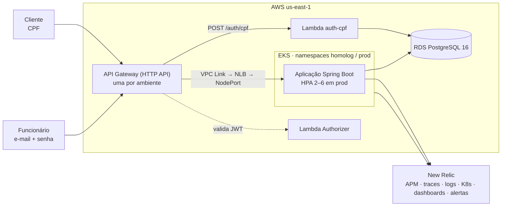

# postech-16soat-app — Tech Challenge, Fase 3

API REST de uma **oficina mecânica**: cadastro de clientes e veículos, ordens de serviço (OS),
orçamentos, estoque de peças e acompanhamento da OS pelo cliente. Java 21 / Spring Boot 3,
arquitetura hexagonal, rodando no **Amazon EKS** atrás de um **API Gateway**, com autenticação de
clientes por **CPF** em uma **Function Serverless**, banco **PostgreSQL gerenciado (RDS)** e
observabilidade no **New Relic**.

Este é o repositório da **aplicação principal** e da **documentação de arquitetura** da fase.

## 🎥 Vídeo de demonstração

**[Demonstração da Fase 3 — YouTube](LINK_DO_VIDEO)** · fase anterior:
[Fase 2](https://www.youtube.com/watch?v=79YrCSF7ioA)

## Repositórios da Fase 3

| Repositório | Papel |
|---|---|
| [postech-16soat-lambda](https://github.com/daniellrsouza/postech-16soat-lambda) | Function Serverless de autenticação por CPF, Lambda Authorizer e rotas do API Gateway |
| [postech-16soat-infra-k8s](https://github.com/daniellrsouza/postech-16soat-infra-k8s) | Terraform: rede, cluster EKS, ECR, NLB interno, API Gateway por ambiente, integração New Relic |
| [postech-16soat-infra-db](https://github.com/daniellrsouza/postech-16soat-infra-db) | Terraform: RDS PostgreSQL 16, databases, usuários e segredos por ambiente |
| **postech-16soat-app** (este) | Aplicação Spring Boot no EKS, manifests Kubernetes, migrations e `docs/` |

Ordem de provisionamento: infra-k8s → infra-db → lambda → app. Todos têm a `main` protegida
(merge só por Pull Request) e CI/CD com deploy automático: `develop` → **homolog**, `main` → **prod**.

## Deploys ativos

| Ambiente | API (API Gateway) | Swagger |
|---|---|---|
| homolog | `https://nb3750pl6g.execute-api.us-east-1.amazonaws.com` | [swagger-ui](https://nb3750pl6g.execute-api.us-east-1.amazonaws.com/swagger-ui.html) |
| prod | `https://xcgp1q2we3.execute-api.us-east-1.amazonaws.com` | [swagger-ui](https://xcgp1q2we3.execute-api.us-east-1.amazonaws.com/swagger-ui.html) |

> O ambiente roda no AWS Academy (Learner Lab): fora das sessões do laboratório, a infraestrutura
> pode estar desligada para economizar o orçamento. As URLs também ficam no SSM, em
> `/tech-challenge/<env>/apigateway-api-endpoint`.

**Postman:** [`tech-challenge-backend/postman/Fase3-API-Gateway.postman_collection.json`](tech-challenge-backend/postman/Fase3-API-Gateway.postman_collection.json),
com o fluxo completo pelo gateway: CPF, login de funcionário, APIs protegidas e ciclo da OS. Os
logins salvam o token automaticamente.

## Arquitetura



Documentação completa em [`docs/`](docs/):

| Documento | Conteúdo |
|---|---|
| [Diagrama de componentes](docs/arquitetura/componentes.md) | Nuvem, APIs, banco e monitoramento |
| [Sequência: autenticação por CPF](docs/arquitetura/sequencia-autenticacao-cpf.md) | Do CPF ao consumo de uma API protegida |
| [Sequência: abertura de OS](docs/arquitetura/sequencia-abertura-os.md) | Da requisição ao evento no New Relic |
| [RFCs](docs/rfc/README.md) | Nuvem, banco, estratégia de autenticação, API Gateway, observabilidade |
| [ADRs](docs/adr/README.md) | 11 decisões arquiteturais (repositórios, ambientes, JWT + authorizer, NLB sem ingress, HPA…) |
| [Modelo de dados](docs/banco/modelo-de-dados.md) | Justificativa do banco, diagrama ER, relacionamentos e ajustes da Fase 3 |
| [Observabilidade](docs/observabilidade/README.md) | O que é monitorado, dashboard importável, uptime e alertas |

### Organização do código

Monólito modular em arquitetura hexagonal, um pacote por contexto delimitado. Cada contexto tem
`domain` → `application` (`ports/in`, `ports/out`, `services`) → `adapters` (`in/web`, `out/...`).
O ArchUnit verifica as regras no build.

| Contexto | Responsabilidade |
|---|---|
| `acesso` | Login de funcionários (e-mail e senha) e emissão de JWT |
| `cadastro` | Clientes (com `status`) e veículos |
| `atendimento` | Ordens de serviço, orçamentos, histórico de status, relatórios, telemetria de negócio |
| `estoque` | Peças, insumos e movimentações |
| `acompanhamento` | Consulta das OS pelo cliente |
| `shared` | Segurança (validação do JWT), correlation id, tratamento de erros, value objects |

## Autenticação

| Quem | Como | Token |
|---|---|---|
| Cliente | `POST /auth/cpf {"cpf": "..."}` → Lambda valida o CPF e verifica se o cliente existe e está `ATIVO` | `role=CLIENTE`, `sub` = id do cliente, 1 h |
| Funcionário / Admin | `POST /auth/login {"email", "password"}` → aplicação | `role=FUNCIONARIO`/`ADMIN`, 1 h |

O **Lambda Authorizer** valida o token na borda; a aplicação revalida e aplica a autorização por
perfil (`@PreAuthorize`). Um segredo HS256 por ambiente é gerado pelo `infra-db`.
Detalhes no [ADR-004](docs/adr/ADR-004-jwt-hs256-lambda-authorizer.md).

## Tecnologias

| Camada | Tecnologia |
|---|---|
| Aplicação | Java 21, Spring Boot 3.5 (Web, Data JPA, Security/OAuth2 Resource Server, Validation, Actuator, Mail), Flyway, springdoc-openapi, iText |
| Banco | PostgreSQL 16 (Amazon RDS), Flyway com `ddl-auto: validate` |
| Testes | JUnit 5, Mockito, Cucumber, Testcontainers, ArchUnit, JaCoCo |
| Infra | Amazon EKS, ECR, API Gateway (HTTP API), Lambda, RDS, SSM Parameter Store, Terraform |
| Kubernetes | Kustomize (base + overlays), HPA, PDB, metrics-server |
| Observabilidade | New Relic (agente Java, eventos de negócio, `nri-bundle`), logs JSON (ECS), CloudWatch |
| CI/CD | GitHub Actions |

## Execução local

Pré-requisitos: Java 21 e Docker. Na pasta `tech-challenge-backend/`:

```bash
cp .env.example .env
docker compose up --build
```

- API: <http://localhost:8080> · Swagger: <http://localhost:8080/swagger-ui.html>
- E-mails de desenvolvimento: MailHog em <http://localhost:8025>

Localmente o login é só pelo `POST /auth/login`; a autenticação por CPF existe na nuvem, via
API Gateway e Lambda. Outras formas de execução e os detalhes estão em
[`tech-challenge-backend/README.md`](tech-challenge-backend/README.md).

## Testes

```bash
cd tech-challenge-backend
./mvnw clean test                                        # unitários, arquitetura e Cucumber
./mvnw verify -Pintegration-tests -Dsurefire.skip=true   # integração com Testcontainers
```

O `SchemaFlywayIT` sobe um PostgreSQL 16 real, aplica todas as migrations e valida as entidades
JPA contra o schema.

## Deploy (CI/CD)

[`.github/workflows/pipeline.yml`](.github/workflows/pipeline.yml):

| Evento | O que roda |
|---|---|
| PR para `develop` ou `main` | Build, testes unitários e de integração |
| push na `develop` | Testes, imagem no ECR (tag = commit) e deploy em **homolog** |
| push na `main` | Testes, imagem no ECR e deploy em **prod** |

O deploy monta o Secret do Kubernetes a partir do SSM (datasource do RDS, `JWT_SECRET` do ambiente)
e dos GitHub Secrets (New Relic, SMTP). Depois aplica o overlay do ambiente
(`tech-challenge-backend/k8s/overlays/<env>`) com a imagem do commit, aguarda o rollout e valida o
`/actuator/health` pelo API Gateway.

Secrets do repositório: `AWS_ACCESS_KEY_ID`, `AWS_SECRET_ACCESS_KEY`, `AWS_SESSION_TOKEN`,
`NEW_RELIC_LICENSE_KEY`, `MAIL_USERNAME`, `MAIL_PASSWORD`.

### Operação no AWS Academy

- `scripts/atualizar-secrets-aws.sh`: renova as credenciais da sessão do lab nos 4 repositórios e
  reinicia nós do EKS que não se registraram depois do fim de uma sessão.
- `scripts/nos.sh` (no `postech-16soat-infra-k8s`): liga e desliga os nós para economizar o orçamento.

---

Pós-graduação em Arquitetura de Software, FIAP (16SOAT)
