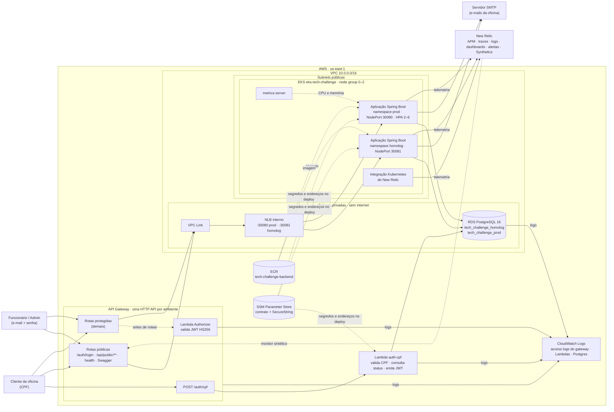

# Diagrama de componentes

Visão da solução na nuvem (AWS, `us-east-1`): APIs, autenticação, cluster, banco e monitoramento.
Os dois ambientes (`homolog` e `prod`) compartilham o cluster EKS, a instância RDS, o NLB e o VPC
Link, e têm cada um sua HTTP API, suas Lambdas, seu namespace, seu database e seus segredos
([ADR-002](../adr/ADR-002-ambientes-por-namespace.md)).

## Componentes

| Componente | Repositório | Papel |
|---|---|---|
| HTTP API (por ambiente) | infra-k8s (API, stage, integração) e lambda (rotas, authorizer) | Entrada única: roteamento, autorização na borda, access log JSON, `X-Correlation-Id` |
| Lambda `auth-cpf` | lambda | Valida o CPF, consulta existência e status do cliente, emite o JWT do cliente |
| Lambda Authorizer | lambda | Valida o JWT de cliente e de funcionário antes das rotas protegidas |
| VPC Link + NLB interno | infra-k8s | Integração privada do gateway com o cluster, um listener por ambiente |
| EKS + node group | infra-k8s | Executa a aplicação; metrics-server alimenta o HPA |
| Aplicação Spring Boot | app | API da oficina: cadastro, OS, orçamentos, estoque, acompanhamento |
| RDS PostgreSQL | infra-db | Dados de cada ambiente em database próprio, com TLS obrigatório |
| SSM Parameter Store | todos | Contrato entre repositórios e distribuição de segredos |
| ECR | infra-k8s | Imagens da aplicação |
| New Relic | app + infra-k8s | APM, traces, logs, métricas do cluster, dashboards, alertas e uptime |
| CloudWatch Logs | AWS | Access logs do gateway, logs das Lambdas e do Postgres |

Fluxos detalhados: [autenticação por CPF](sequencia-autenticacao-cpf.md) e
[abertura de ordem de serviço](sequencia-abertura-os.md).
