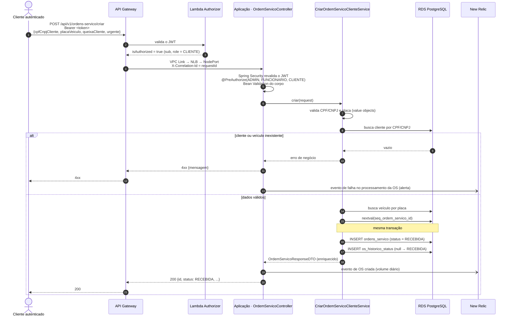

# Diagrama de sequência — abertura de ordem de serviço

Abertura de OS por um cliente autenticado (o mesmo endpoint aceita `ADMIN` e `FUNCIONARIO`).
Caso de uso: `CriarOrdemServicoClienteService`, contexto `atendimento`.

Depois da abertura, cada mudança de status (`EM_DIAGNOSTICO`, `AGUARDANDO_APROVACAO`,
`EM_EXECUCAO`, `FINALIZADA`, `ENTREGUE`) grava uma linha em `os_historico_status` e emite um evento
com o tempo gasto no status anterior. Esses eventos alimentam o dashboard de tempo médio por status.
