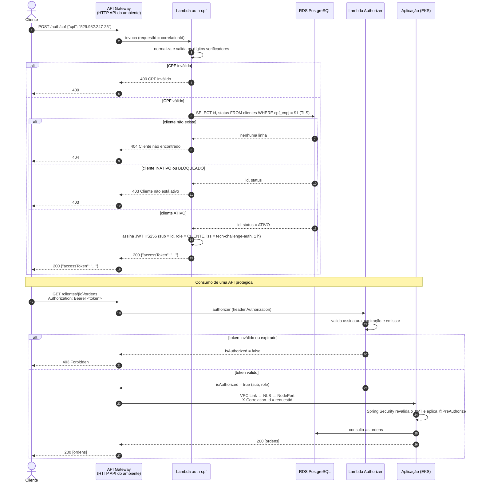

# Diagrama de sequência — autenticação por CPF

O cliente obtém um token com o CPF e o usa nas rotas protegidas. A decisão está no
[ADR-004](../adr/ADR-004-jwt-hs256-lambda-authorizer.md) e na
[RFC-003](../rfc/RFC-003-estrategia-autenticacao.md).

Sem o header `Authorization`, o gateway responde 401 sem chamar o authorizer. O mesmo
`correlationId` aparece no access log do gateway, nos logs das Lambdas e nos logs da aplicação.
