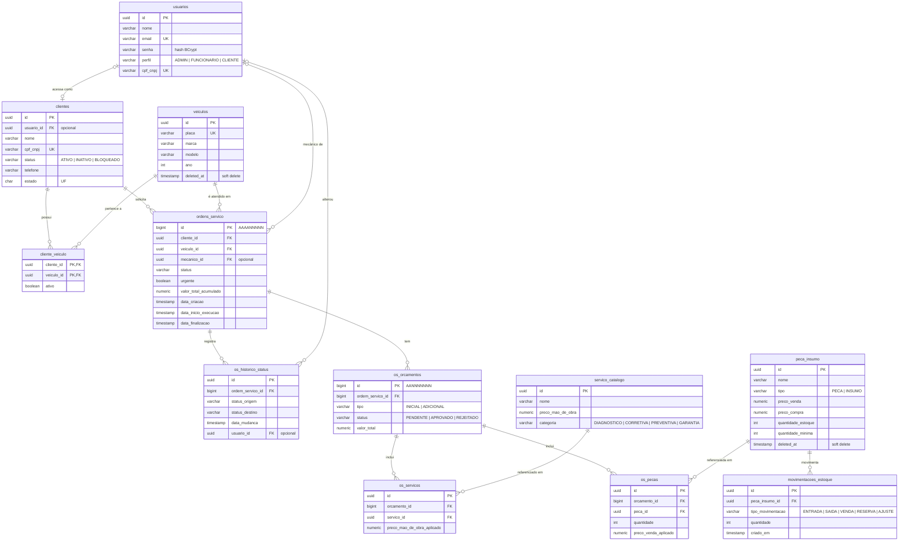

# Banco de dados: justificativa e modelo relacional

Documento exigido pela Fase 3: justificativa formal da escolha do banco, ajustes no modelo
relacional, diagrama ER e explicação dos relacionamentos. A comparação completa das opções está na
[RFC-002](../rfc/RFC-002-escolha-do-banco.md); a infraestrutura, no repositório
`postech-16soat-infra-db`.

## 1. Justificativa da escolha: PostgreSQL 16 no Amazon RDS

**Por que relacional.** O domínio da oficina é fortemente relacional e transacional:

- uma ordem de serviço (OS) pertence a um cliente e a um veículo, tem orçamentos, e cada orçamento
  tem itens de serviço e de peça com preço aplicado no momento;
- abrir uma OS grava a OS e a primeira entrada do histórico de status **na mesma transação**;
- aprovar um orçamento e movimentar estoque precisam de integridade referencial (não existe item de
  orçamento sem orçamento, nem movimentação sem peça).

Esses invariantes são garantidos pelo banco com chaves estrangeiras, `CHECK` e `UNIQUE`, e não só
pelo código. Um banco chave-valor ou de documentos (ex.: DynamoDB) levaria essas regras para a
aplicação e exigiria reescrever toda a camada de persistência.

**Por que PostgreSQL.** É o mesmo banco das Fases 1 e 2: as 16 migrations Flyway, as consultas JPQL
e os testes de integração rodam sem mudança. Oferece `UUID`, sequências (ids legíveis de OS e
orçamento), `CHECK`, índices compostos e privilégios por coluna, todos usados no modelo.

**Por que gerenciado (RDS).** Na Fase 2 o banco rodava como StatefulSet no cluster, com backup,
atualização e disponibilidade por conta do time. No RDS:

| Necessidade | Como o RDS atende neste projeto |
|---|---|
| Disponibilidade e backups | Backup automático diário; *point-in-time recovery* dentro da retenção |
| Segurança | Subnets privadas sem internet, sem IP público, TLS obrigatório (`rds.force_ssl`), disco criptografado, senha master no Secrets Manager |
| Isolamento por ambiente | Um database por ambiente, com usuários próprios e `CONNECT` só no próprio database |
| Performance observável | Log de consultas acima de 500 ms exportado para o CloudWatch |
| Operação | Atualizações de versão menor automáticas; parâmetros versionados em Terraform |

**Limitação aceita:** instância `db.t3.micro` **Single-AZ**, sem failover automático, por causa do
orçamento do laboratório. Em produção real, o caminho é Multi-AZ com uma classe maior, o que só
exige mudar `multi_az` e `instance_class` no Terraform.

## 2. Diagrama ER

## 3. Relacionamentos

| Relacionamento | Cardinalidade | Regra no banco | Por quê |
|---|---|---|---|
| `usuarios` → `clientes` | 0..1 : 0..1 | `usuario_id` opcional, `ON DELETE SET NULL` | Cliente pode existir sem login; apagar o usuário não apaga o cadastro do cliente |
| `clientes` ↔ `veiculos` | N : N via `cliente_veiculo` | PK composta, `ON DELETE CASCADE`, flag `ativo` | Um veículo troca de dono e um cliente tem vários veículos; o vínculo é histórico |
| `clientes` → `ordens_servico` | 1 : N | `ON DELETE RESTRICT` | Cliente com OS não pode ser apagado (trilha de atendimento) |
| `veiculos` → `ordens_servico` | 1 : N | `ON DELETE RESTRICT` | Idem para o veículo atendido |
| `usuarios` (mecânico) → `ordens_servico` | 0..1 : N | `ON DELETE SET NULL` | A OS sobrevive à saída do mecânico |
| `ordens_servico` → `os_historico_status` | 1 : N | `ON DELETE CASCADE`, `CHECK` dos status | Trilha de auditoria de cada mudança; base do tempo médio por status |
| `ordens_servico` → `os_orcamentos` | 1 : N | `ON DELETE CASCADE`, `CHECK` de tipo e status | Orçamento inicial e adicionais, cada um aprovado ou rejeitado pelo cliente |
| `os_orcamentos` → `os_servicos` / `os_pecas` | 1 : N | `ON DELETE CASCADE` | Itens só existem dentro do orçamento |
| `servico_catalogo` / `peca_insumo` → itens | 1 : N | `ON DELETE RESTRICT` | Não se apaga do catálogo o que já foi orçado; o preço aplicado fica gravado no item |
| `peca_insumo` → `movimentacoes_estoque` | 1 : N | `CHECK` de tipo e quantidade > 0 | Histórico do estoque; a quantidade atual fica em `peca_insumo` |

Identificadores: UUID nas entidades de cadastro e nos itens; `BIGINT` gerado por sequência nas OS
(`AAAANNNNN`) e nos orçamentos (`AANNNNNNN`), para ids legíveis por pessoas e citáveis em e-mails.

## 4. Ajustes no modelo relacional (Fase 3)

Todos feitos com **migrations novas** (V17 a V20), sem alterar as já aplicadas, e verificados pelo
teste `SchemaFlywayIT`. O teste roda todas as migrations em PostgreSQL 16 real e valida as
entidades JPA contra o schema.

| # | Ajuste | Migration | Tipo | Justificativa |
|---|---|---|---|---|
| A | Coluna `clientes.status` (`ATIVO`/`INATIVO`/`BLOQUEADO`, `CHECK`, default `ATIVO`) + `GRANT SELECT (id, cpf_cnpj, status)` ao papel `leitura_clientes` | V17 | Consistência e segurança | A Function de autenticação precisa consultar o status do cliente; o usuário da Lambda só enxerga as três colunas de que precisa |
| B | `CHECK` de `movimentacoes_estoque.tipo_movimentacao` passa a aceitar `VENDA` e `RESERVA` | V18 | Consistência (**bug**) | A V9 tentou isso com `CREATE TABLE IF NOT EXISTS` e não teve efeito; a venda de peça falhava no banco |
| C | Índices `ordens_servico(status, urgente DESC, data_criacao)`, `ordens_servico(cliente_id, data_criacao DESC)` e `os_historico_status(ordem_servico_id, data_mudanca)`, substituindo os simples | V19 | Performance | Casam com o `WHERE`/`ORDER BY` das listagens priorizadas, do acompanhamento do cliente e da leitura do histórico |
| D | Índices em `ordens_servico.veiculo_id` e `mecanico_id` | V19 | Performance | Joins de enriquecimento da OS e verificação das FKs ao excluir veículos e usuários |
| E | Remoção de `idx_usuario_email`, `idx_usuario_cpf_cnpj`, `idx_cliente_cpf_cnpj`, `idx_veiculo_placa` | V19 | Performance | Duplicavam o índice que as constraints `UNIQUE` já criam: só custavam escrita e espaço |
| F | `spring.jpa.hibernate.ddl-auto: validate` (antes `update`) | config | Consistência | O schema passa a ser responsabilidade exclusiva do Flyway; o Hibernate só confere. A única divergência encontrada (`clientes.estado` é `CHAR(2)`) foi corrigida no mapeamento |
| G | CPF inválido do seed corrigido (`10387398790` → `10387398708`) | V20 | Consistência dos dados | A aplicação só validava o formato; a Function valida os dígitos verificadores e recusava esse cliente |

### Acesso por ambiente

| Papel / usuário | Onde conecta | O que pode |
|---|---|---|
| `app_<env>` | `tech_challenge_<env>` | Dono do schema: migrations (Flyway) e operações da aplicação |
| `lambda_<env>` (membro de `leitura_clientes`) | `tech_challenge_<env>` | Só `SELECT (id, cpf_cnpj, status)` em `clientes` |
| `postgres_admin` (master) | todos | Só o Job de bootstrap; senha no Secrets Manager |

Verificado em homolog: o usuário da Lambda não cria tabela nem conecta no database administrativo, e
conexões sem TLS são recusadas.

## 5. Pontos conhecidos, fora do escopo da fase

- A V11 classifica peças e insumos por ids que não pertencem a `peca_insumo` e roda antes do seed
  (V13); por isso, todas as peças do seed ficam como `PECA`.
- O `GET /clientes/{cpfCnpj}` devolve `rua` e `numero` trocados (mapeamento no serviço, não no banco).
